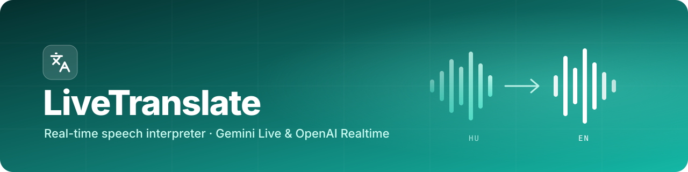
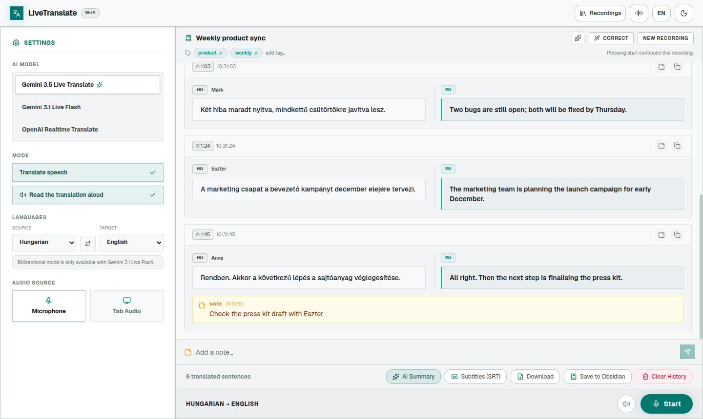
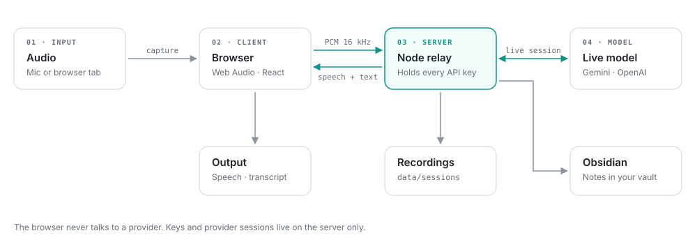

<p align="center">
  
</p>

<p align="center">
  <b>Beszélj, vagy oszd meg egy meeting böngészőfülét. A fordítást egy pillanattal később hallod.</b><br>
  Utána megmarad a kétnyelvű átirat, egy AI-összefoglaló és egy Obsidian-jegyzet.
</p>

<p align="center">
  
  
  
  
  
  
</p>

<p align="center">
  
  
  
  
  
</p>

<p align="center">
  <a href="#gyors-kezdés"><b>Gyors kezdés</b></a> &nbsp;·&nbsp;
  <a href="#funkciók"><b>Funkciók</b></a> &nbsp;·&nbsp;
  <a href="#hogyan-működik"><b>Hogyan működik</b></a> &nbsp;·&nbsp;
  <a href="#beállítások"><b>Beállítások</b></a> &nbsp;·&nbsp;
  <a href="README.md"><b>English</b></a>
</p>

<br>

<picture>
  <source media="(prefers-color-scheme: dark)" srcset=".github/readme/screenshot-dark.png">
  
</picture>

<p align="center"><sub>Egy felvett meeting: minden szakasznál látszik a beszélő, a magyar eredeti és az angol fordítás, az utolsónál egy csatolt jegyzettel.</sub></p>

## Áttekintés

Fárasztó egy olyan meeting, amelynek a nyelvét csak félig érted. A LiveTranslate a mikrofonodat vagy egy böngészőfület hallgat, és egyszerre három dolgot csinál:

- **Hangosan tolmácsol.** A lefordított beszédet hallod.
- **Mindent leír.** Az eredeti és a fordítás egymás mellett, időbélyeggel, a természetes szüneteknél szakaszokra bontva.
- **Utána összefoglal.** AI-összefoglaló angolul és magyarul, generált cím, és egy jegyzet az Obsidian-tárolódba.

A felvétel menet közben lemezre mentődik. Egy oldalfrissítés, egy összeomlás vagy egy megszakadt kapcsolat nem viszi el a meetinget.

## Gyors kezdés

> [!IMPORTANT]
> Kell hozzá **Node.js 20+** és egy **Gemini API-kulcs**. Az OpenAI-kulcs opcionális.

```bash
npm install
cp .env.example .env      # írd bele a GEMINI_API_KEY-t
npm run dev               # http://localhost:3000
```

Nyisd meg az oldalt, válassz nyelvpárt, és nyomd meg a **Start** gombot.

<details>
<summary><b>Futtatás a háttérben</b></summary>

<br>

```bash
./start.sh    # buildel, majd a háttérben futtatja a dist/server.cjs-t
./stop.sh     # leállítja
```

A PID és a napló a `.run/` mappába kerül (`.run/live-translate.log`). Állapot-ellenőrzés: `GET /api/health`. A portot a `PORT` változóval lehet átállítani.

</details>

<details>
<summary><b>Hibaelhárítás</b></summary>

<br>

- **Hiányzik a `.env`:** hozd létre a `.env.example` alapján.
- **Hiányzik a `node_modules`:** futtasd az `npm install` parancsot.
- **Nem indul a szerver:** nézd meg a naplót: `tail -f .run/live-translate.log`.
- **Megmaradt a PID-fájl, de a folyamat már nem fut:** a `stop.sh` ezt magától eltakarítja.

</details>

## Funkciók

<table>
<tr>
<td width="50%" valign="top">

### Élő tolmácsolás
- **Bármely nyelvpár** a 27 nyelvből, menet közben is felcserélhető
- **Kétirányú mód**: mindkét fél beszél, mindegyikük a másik nyelvére fordítódik
- **Mikrofon vagy böngészőfül hangja**, így egy Teams-, Meet- vagy Zoom-fül közvetlenül használható
- **Szünetalapú szakaszolás**: a hosszú monológokból olvasható kártyák lesznek

</td>
<td width="50%" valign="top">

### Felvételtár
- **Automatikus mentés** lemezre néhány másodpercenként, hiba esetén újrapróbálva
- **Folytatás**: bármelyik felvétel később folytatható, akár más módban is
- **Nevek és címkék**, AI által javasolt címmel az elhangzottak alapján
- **Teams-import**: egy lezajlott meeting átiratát beillesztve minden funkció működik rajta

</td>
</tr>
<tr>
<td width="50%" valign="top">

### AI-eszközök
- **Összefoglaló** angolul és magyarul egyetlen kérésben, hosszabb meetingnél hosszabb
- **Jegyzetek** a hívás közben, önállóan vagy egy szakaszhoz csatolva
- **Javítások**: tanítsd meg neki, hogy a „Cooper Netties” valójában „Kubernetes”; javítja az átiratot és irányítja a fordítást
- **Választható szolgáltató**: Gemini, OpenAI vagy helyi Ollama

</td>
<td width="50%" valign="top">

### Export
- **TXT, Markdown vagy PDF**, teljes Unicode-támogatással (`ő` és `ű` is)
- **Kétnyelvű SRT** felirat, helyes sorrendű időzítéssel
- **Mentés Obsidianba**: dátumozott jegyzet frontmatterrel és címkékkel, újramentéskor frissül
- **Világos és sötét téma**, angol és magyar felület

</td>
</tr>
</table>

### Három mód

| | Mód | Mit kapsz | Költség |
|:---:|---|---|---|
|  | **Tolmács** | Hangos fordítás és kétnyelvű átirat | Legmagasabb |
|  | **Fordított átirat** | Néma; minden lezárt szakasz szövegként fordítódik | Alacsonyabb |
|  | **Sima felvétel** | Átirat csak az elhangzott nyelven | Legalacsonyabb |

## Hogyan működik

<picture>
  <source media="(prefers-color-scheme: dark)" srcset=".github/readme/architecture-dark.svg">
  
</picture>

### Hosszú meetingek

Egy 40 perces meetingen olyan gondok jönnek elő, amelyeket egy rövid teszt sosem mutat meg. Ezeket az app kezeli:

| Probléma | Megoldás |
|---|---|
| A Gemini Live session 7–10 perc után megszűnik | A szerver még a régi megszűnése előtt nyit egy újat, és átvált rá; a kliens semmit nem vesz észre |
| A kapcsolat mégis megszakad | Magától újracsatlakozik, ugyanazzal a hangfolyammal, új engedélykérés nélkül |
| A szövegmodell óránként többször `503 high demand` hibát ad | Növekvő várakozással újrapróbálkozik, kimerült kvótánál pedig annyit vár, amennyit a szolgáltató kér |
| Az automatikus nyelvfelismerés elcsúszik (angol beszédből spanyol átirat lesz) | A beszédfelismerő megkapja, milyen nyelveken beszélnek |
| Oldalfrissítés meeting közben | A felvétel már a lemezen van; a felvételtárból újra megnyitható |

## Modellek

| Modell | Szolgáltató | Nyelvek | Kétirányú | Mire jó |
|---|:---:|---|:---:|---|
| `gemini-3.5-live-translate-preview` |  | Mind a 27 | – | Kifejezetten beszédről beszédre fordít |
| `gemini-3.1-flash-live-preview` |  | Mind a 27 | ✓ | Kétirányú beszélgetések; ez futtatja a néma módokat is |
| `gpt-realtime-translate` |  | 14 be, 13 ki | – | Alternatív hang; érti a magyart, de magyarul nem tud beszélni |

A nyelvkatalógus és az egyes modellek szabályai a [`shared/languages.ts`](shared/languages.ts) fájlban vannak.

## Beállítások

Másold a `.env.example` fájlt `.env` néven. Ha egy kulcs hiányzik, csak az azt igénylő funkciók nem működnek; a szerver fut tovább.

| Változó | Szerepe |
|---|---|
| `GEMINI_API_KEY` | A Gemini Live modellek és az alapértelmezett összefoglaló-szolgáltató |
| `OPENAI_API_KEY` | `gpt-realtime-translate` |
| `SUMMARY_PROVIDER` | `gemini` (alapértelmezett), `openai` vagy `ollama`: összefoglalók, címek és szakaszfordítás |
| `SUMMARY_MODEL` | Alapértelmezések: `gemini-flash-latest`, `gpt-4o-mini`, `llama3.1` |
| `SUMMARY_API_KEY`, `SUMMARY_BASE_URL` | Szolgáltatónkénti kulcs és végpont felülírása |
| `OBSIDIAN_VAULT_DIR` | Ide mentődnek a jegyzetek (alapértelmezés: `./data/vault/meetings`) |
| `SESSIONS_DIR` | Ide mentődnek a felvételek (alapértelmezés: `./data/sessions`) |
| `PORT` | HTTP- és WebSocket-port (alapértelmezés: `3000`) |

> [!NOTE]
> Az ingyenes Gemini-kulcsoknak csak a `*-latest` aliasokra van kvótájuk. A rögzített azonosítók, például a `gemini-2.0-flash`, `429 limit: 0` hibát adnak.

> [!TIP]
> Az összefoglaló-szolgáltató független az élő tolmácsolásétól: egy helyi Ollama is adhat címet és összefoglalót, miközben a Gemini tolmácsol.

## Fejlesztés

```bash
npm run dev     # Express + Vite middleware a :3000 porton
npm run lint    # típusellenőrzés (tsc --noEmit)
npm test        # Vitest egységtesztek
npm run build   # Vite frontend + esbuild szerver → dist/server.cjs
npm start       # a production build futtatása
```

<details>
<summary><b>Projektszerkezet</b></summary>

<br>

```
server.ts                 Express + WebSocket belépési pont, HTTP API, session-rotáció
server/
  providers/              gemini · openai · textModel · summary · textTranslate
  instructions.ts         Nyelvpár → rendszerutasítás
  sessions.ts             Lemezen tárolt felvételek
  obsidian.ts             Obsidian-jegyzet írása
  corrections.ts          Globális javítási szabályok
shared/                   A szerver és a böngésző is használja
  protocol.ts             WebSocket-üzenettípusok
  languages.ts            Nyelvkatalógus és modellszabályok
  session.ts              A tárolt felvétel formátuma
  corrections.ts          Javítások illesztése és glosszárium
  transcriptImport.ts     Teams-átirat feldolgozása
src/
  App.tsx                 Gyökérkomponens és állapot
  components/             Header, SettingsPanel, TranscriptList, SessionBar, RecordingsDrawer, dialógusok
  hooks/                  Hangrögzítés és -lejátszás, WebSocket-session, automatikus mentés, görgetés
  lib/                    PCM, idő, export, PDF
  i18n.ts                 Angol és magyar felületi szövegek
```

</details>

Az architektúra részletei és a tervezés mögötti, mért API-korlátok a [`CLAUDE.md`](CLAUDE.md) fájlban vannak (angolul).
