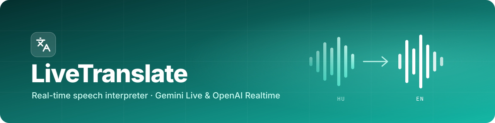
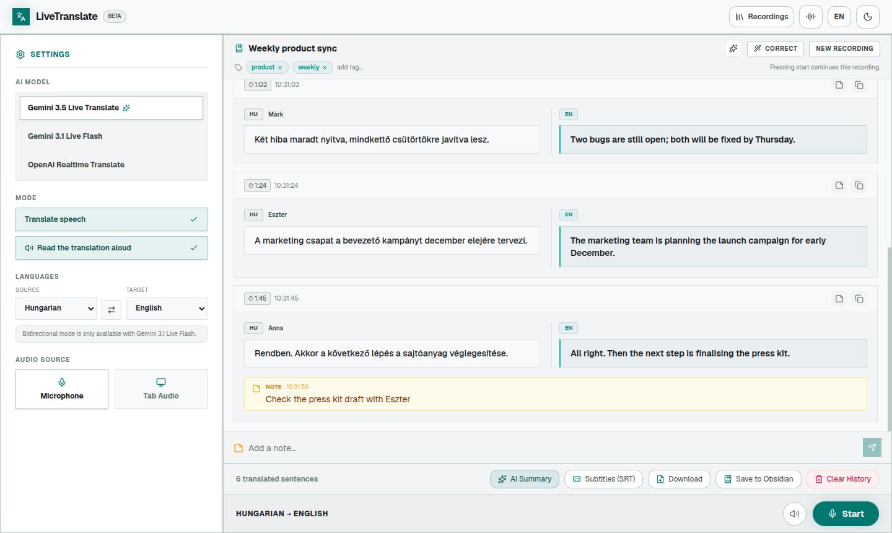
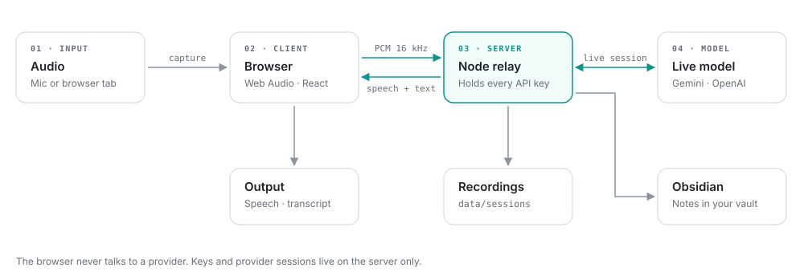

<p align="center">
  
</p>

<p align="center">
  <b>Speak, or share a meeting tab. Hear the translation a moment later.</b><br>
  Keep a bilingual transcript, an AI summary and an Obsidian note afterwards.
</p>

<p align="center">
  
  
  
  
  
  
</p>

<p align="center">
  
  
  
  
  
</p>

<p align="center">
  <a href="#quick-start"><b>Quick start</b></a> &nbsp;·&nbsp;
  <a href="#features"><b>Features</b></a> &nbsp;·&nbsp;
  <a href="#how-it-works"><b>How it works</b></a> &nbsp;·&nbsp;
  <a href="#configuration"><b>Configuration</b></a> &nbsp;·&nbsp;
  <a href="README.hu.md"><b>Magyar</b></a>
</p>

<br>

<picture>
  <source media="(prefers-color-scheme: dark)" srcset=".github/readme/screenshot-dark.png">
  
</picture>

<p align="center"><sub>A recorded meeting: each segment shows the speaker, the original Hungarian and the English translation, with a note attached.</sub></p>

## Overview

Meetings in a language you only half follow are tiring. LiveTranslate listens to your microphone or a browser tab and does three jobs at once:

- **Interprets out loud.** You hear the translated speech.
- **Writes everything down.** Original and translation side by side, timed, split into segments at natural pauses.
- **Summarizes afterwards.** An AI summary in English and Hungarian, a generated title, and a note saved to your Obsidian vault.

Recordings are saved to disk as you go. A page refresh, a crash or a dropped connection does not lose the meeting.

## Quick start

> [!IMPORTANT]
> You need **Node.js 20+** and a **Gemini API key**. An OpenAI key is optional.

```bash
npm install
cp .env.example .env      # add your GEMINI_API_KEY
npm run dev               # http://localhost:3000
```

Open the page, choose a language pair and press **Start**.

<details>
<summary><b>Run it in the background</b></summary>

<br>

```bash
./start.sh    # builds, then runs dist/server.cjs in the background
./stop.sh     # stops it
```

The PID and the log are written to `.run/` (`.run/live-translate.log`). Health check: `GET /api/health`. Set `PORT` to change the port.

</details>

## Features

<table>
<tr>
<td width="50%" valign="top">

### Live interpreting
- **Any pair** from 27 languages, swappable during a session
- **Bidirectional mode**: both sides speak, each is translated for the other
- **Microphone or tab audio**, so a Teams, Meet or Zoom tab works directly
- **Pause-based segmentation** turns long monologues into readable cards

</td>
<td width="50%" valign="top">

### Recordings library
- **Autosave** to disk every few seconds, with retries
- **Resume** any recording later, even in a different mode
- **Names and tags**, with an AI-generated title from what was said
- **Teams import**: paste a finished meeting's transcript and use every feature on it

</td>
</tr>
<tr>
<td width="50%" valign="top">

### AI tools
- **Summary** in English and Hungarian in one request, longer for longer meetings
- **Notes** typed during the call, standalone or attached to a segment
- **Corrections**: teach it that "Cooper Netties" means "Kubernetes"; it fixes the transcript and steers the translation
- **Your choice of provider**: Gemini, OpenAI or a local Ollama

</td>
<td width="50%" valign="top">

### Export
- **TXT, Markdown or PDF**, with full Unicode (Hungarian `ő` and `ű` included)
- **Bilingual SRT** subtitles with correctly ordered timing
- **Save to Obsidian**: a dated note with frontmatter and tags, updated in place
- **Light and dark theme**, English and Hungarian interface

</td>
</tr>
</table>

### Three modes

| | Mode | What you get | Cost |
|:---:|---|---|---|
|  | **Interpreter** | Spoken translation and a bilingual transcript | Highest |
|  | **Translated transcript** | Silent; each finished segment is translated as text | Lower |
|  | **Plain recording** | Transcript in the spoken language only | Lowest |

## How it works

<picture>
  <source media="(prefers-color-scheme: dark)" srcset=".github/readme/architecture-dark.svg">
  
</picture>

### Long-meeting handling

A 40-minute meeting runs into problems that a short test never shows. These are handled:

| Problem | Handling |
|---|---|
| Gemini Live sessions end after 7–10 minutes | The server opens a replacement session before the old one ends and swaps them; the client sees no interruption |
| The connection drops anyway | Reconnects automatically and keeps the same audio stream, without a new permission prompt |
| The text model returns `503 high demand` several times an hour | Retries with backoff, and when a quota is exhausted waits as long as the provider asks |
| Automatic language detection drifts (English transcribed as Spanish) | The speech recognizer is told which languages are spoken |
| A page refresh mid-meeting | The recording is already on disk; reopen it from the library |

## Models

| Model | Provider | Languages | Two-way | Use |
|---|:---:|---|:---:|---|
| `gemini-3.5-live-translate-preview` |  | All 27 | – | Dedicated speech-to-speech translation |
| `gemini-3.1-flash-live-preview` |  | All 27 | ✓ | Two-way conversations; also runs the silent modes |
| `gpt-realtime-translate` |  | 14 in, 13 out | – | Alternative voice; understands Hungarian but cannot speak it |

The language catalogue and each model's rules are in [`shared/languages.ts`](shared/languages.ts).

## Configuration

Copy `.env.example` to `.env`. A missing key only disables the features that need it; the server keeps running.

| Variable | Purpose |
|---|---|
| `GEMINI_API_KEY` | Gemini Live models and the default summary provider |
| `OPENAI_API_KEY` | `gpt-realtime-translate` |
| `SUMMARY_PROVIDER` | `gemini` (default), `openai` or `ollama`, for summaries, titles and segment translation |
| `SUMMARY_MODEL` | Defaults: `gemini-flash-latest`, `gpt-4o-mini`, `llama3.1` |
| `SUMMARY_API_KEY`, `SUMMARY_BASE_URL` | Per-provider key and endpoint overrides |
| `OBSIDIAN_VAULT_DIR` | Where notes are saved (default `./data/vault/meetings`) |
| `SESSIONS_DIR` | Where recordings are stored (default `./data/sessions`) |
| `PORT` | HTTP and WebSocket port (default `3000`) |

> [!NOTE]
> Free-tier Gemini keys only have quota for the `*-latest` aliases. Pinned ids such as `gemini-2.0-flash` fail with `429 limit: 0`.

> [!TIP]
> The summary provider is independent of the live one: a local Ollama can title and summarize meetings while Gemini does the interpreting.

## Development

```bash
npm run dev     # Express + Vite middleware on :3000
npm run lint    # type-check (tsc --noEmit)
npm test        # Vitest unit tests
npm run build   # Vite frontend + esbuild server → dist/server.cjs
npm start       # run the production build
```

<details>
<summary><b>Project layout</b></summary>

<br>

```
server.ts                 Express + WebSocket entry point, HTTP API, session rotation
server/
  providers/              gemini · openai · textModel · summary · textTranslate
  instructions.ts         Language pair → system instruction
  sessions.ts             On-disk recordings store
  obsidian.ts             Obsidian note writer
  corrections.ts          Global correction rules
shared/                   Used by both server and browser
  protocol.ts             WebSocket message types
  languages.ts            Language catalogue and model rules
  session.ts              Stored recording format
  corrections.ts          Correction matching and glossary
  transcriptImport.ts     Teams transcript parser
src/
  App.tsx                 Root component and state
  components/             Header, SettingsPanel, TranscriptList, SessionBar, RecordingsDrawer, dialogs
  hooks/                  Audio capture and playback, WebSocket session, autosave, scrolling
  lib/                    PCM, time, export, PDF
  i18n.ts                 English and Hungarian UI strings
```

</details>

Architecture details and the measured API limits behind the design are in [`CLAUDE.md`](CLAUDE.md).
